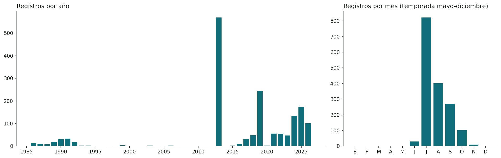

# humpback-habitat-colombia

Modelo abierto y reproducible del hábitat estacional de la ballena jorobada (*Megaptera novaeangliae*) en el Pacífico colombiano, construido con avistamientos de GBIF y OBIS y variables oceánicas de Earth Engine, con corrección del sesgo de muestreo turístico.

## Contexto

La población del Hemisferio Sur (stock G de la IWC) llega al Pacífico colombiano entre mayo y diciembre para reproducirse y criar. El área Gorgona-Tribugá-Malpelo está reconocida como Área Importante para Mamíferos Marinos (IMMA).

Casi todos los registros públicos vienen de zonas de avistamiento turístico (Bahía Solano, Nuquí, Bahía Málaga, Gorgona). Un modelo que no corrija ese sesgo termina mostrando dónde hay lanchas, no dónde hay ballenas. Este repositorio busca resolver eso con código abierto y que se actualice cada temporada.

## Fase 0: qué datos hay




- **1.633 registros útiles** (fecha, coordenadas, en el mar y sin duplicados): 1.631 de GBIF y 2 de OBIS. Supera el umbral de 300, así que el modelo sigue en el Pacífico colombiano.
- **Dos tipos de dato que no se mezclan.** 1.065 son avistamientos (Happywhale, iNaturalist, cruceros de la NOAA y proyectos locales) y 568 son telemetría satelital de 2013: pocas ballenas marcadas, registradas muchas veces. El pico de 2013 en la gráfica es esa telemetría, no un año con más ballenas.
- **Sesgo turístico confirmado.** El 66 % de los registros cae a menos de 25 km de Bahía Solano, Nuquí y Tribugá, Bahía Málaga o Gorgona; solo Bahía Solano reúne 586.
- **La curva mensual sigue la temporada turística.** Julio concentra unos 820 registros y mayo casi ninguno, aunque las ballenas llegan hacia finales de mayo (Avila et al., 2020).
- **Lo más valioso para el modelo** son los registros lejos de los sitios turísticos: la telemetría, que recorre la costa hacia el sur, y los cruceros científicos con esfuerzo controlado.

## Fases

| Fase | Qué hace | Estado |
|---|---|---|
| 0 | Descarga y conteo de avistamientos (GBIF, OBIS): mapa, año, mes, sesgo | Hecha |
| 1 | Variables oceánicas en Earth Engine (temperatura, clorofila, batimetría) y puntos de fondo corregidos por esfuerzo | En curso |
| 2 | Modelo de hábitat con fondo de muestreo ponderado por esfuerzo | Pendiente |
| 3 | Mapa estacional automatizado con GitHub Actions | Pendiente |

Criterio de la fase 0: con 300 registros útiles o más (fecha, coordenadas, en el mar y sin duplicados) se sigue con el modelo en el Pacífico colombiano. Con menos, la zona se amplía al rango de la población G (Panamá, Costa Rica, Ecuador).

## Estructura

```
notebooks/
  01_fase0_datos.ipynb       descarga, limpieza, mapa y gráficas
  02_fase1_variables.ipynb   variables del mar en Earth Engine y puntos de fondo
scripts/
  mapa_avistamientos.py      mapa del README a partir del CSV
data/                        datos descargados (no se versionan)
docs/img/                figuras para este README
```

## Cómo correrlo

1. `notebooks/01_fase0_datos.ipynb` en Google Colab: descarga los avistamientos. No necesita GPU.
2. `notebooks/02_fase1_variables.ipynb`: requiere una cuenta de Earth Engine con un proyecto de Google Cloud.

## Fuentes de datos

- GBIF, Global Biodiversity Information Facility: https://www.gbif.org
- OBIS, Ocean Biodiversity Information System: https://obis.org
- Natural Earth (línea de costa): https://www.naturalearthdata.com

Cada registro conserva el conjunto de datos de origen; al publicar resultados se citan los conjuntos usados según la licencia de cada uno.

## Referencias

- Avila, I. C., Dormann, C. F., García, C., Payán, L. F. y Zorrilla, M. X. (2020). Humpback whales extend their stay in a breeding ground in the Tropical Eastern Pacific. *ICES Journal of Marine Science*, 77(1), 109-118.
- IUCN MMPATF. Gorgona-Tribugá-Malpelo IMMA, factsheet.
- Palacios, D. M. et al. (2012). Cetacean distribution and relative abundance in Colombia's Pacific EEZ. *Journal of Cetacean Research and Management*.

## Autora

Tatiana Zamudio, ingeniera topográfica, magíster en Inteligencia Artificial.
