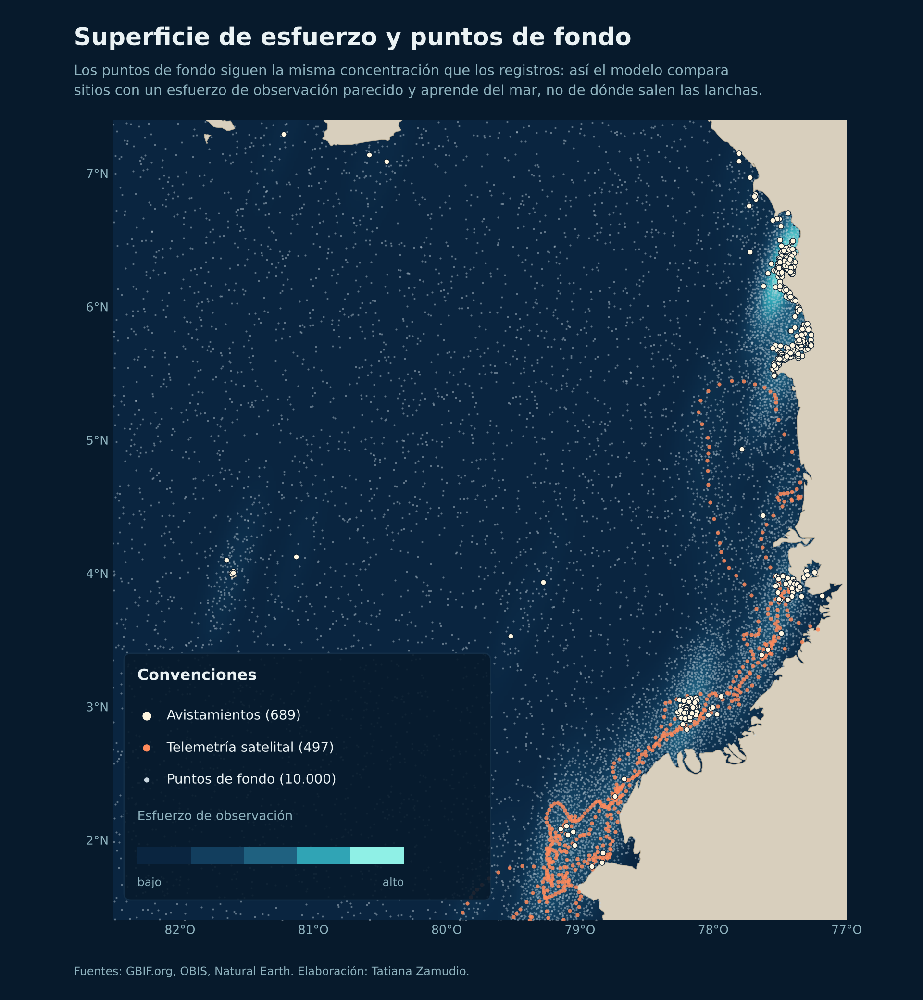
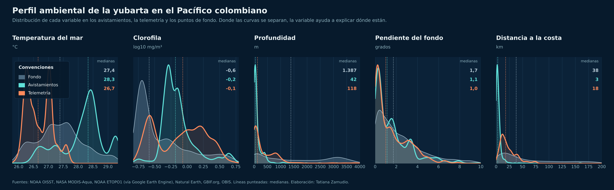
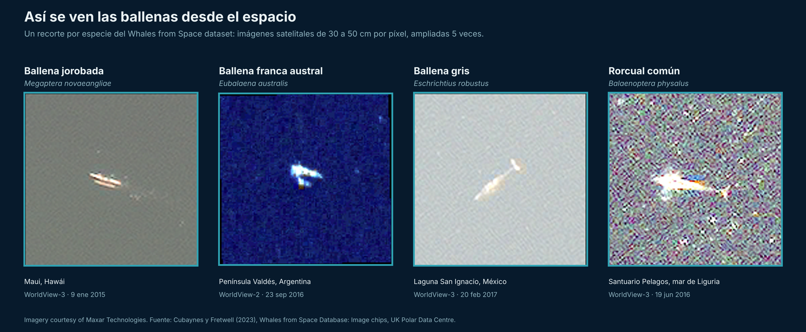

# humpback-habitat-colombia

<div align="justify">

Modelo abierto y reproducible del hábitat estacional de la ballena jorobada (*Megaptera novaeangliae*) en el Pacífico colombiano, construido con avistamientos de GBIF y OBIS y variables oceánicas de Earth Engine, con corrección del sesgo de muestreo turístico.

## Contexto

La población del Hemisferio Sur (stock G de la IWC) llega al Pacífico colombiano entre mayo y diciembre para reproducirse y criar. El área Gorgona-Tribugá-Malpelo está reconocida como Área Importante para Mamíferos Marinos (IMMA).

Casi todos los registros públicos vienen de zonas de avistamiento turístico (Bahía Solano, Nuquí, Bahía Málaga, Gorgona). Un modelo que no corrija ese sesgo termina señalando los lugares donde más gente sale a buscar ballenas, en vez de los lugares que las ballenas prefieren. Este repositorio busca resolver eso con código abierto y que se actualice cada temporada.

## Fase 0: qué datos hay

El primer paso fue responder una pregunta simple: ¿hay suficientes registros públicos de ballena jorobada en el Pacífico colombiano para construir un modelo? El notebook `notebooks/01_fase0_datos.ipynb` descarga todos los registros de GBIF y OBIS dentro de la zona de estudio (82,5° O a 77° O, 1,4° N a 7,4° N), quita los que no tienen fecha, los duplicados entre las dos fuentes y los que caen en tierra.

Resultado: **1.633 registros útiles** (1.631 de GBIF y 2 de OBIS), cinco veces el mínimo de 300 que se fijó para seguir. Pero los datos no son homogéneos, y las dos figuras siguientes muestran por qué.

### Dónde están los registros


**Qué muestra.** Cada punto blanco es un avistamiento y cada punto coral es una posición de telemetría satelital. Los círculos punteados marcan 25 km alrededor de los cuatro sitios de avistamiento turístico (Bahía Solano, Nuquí y Tribugá, Bahía Málaga y Gorgona), con el número de registros que cae dentro de cada uno. El fondo es la profundidad del mar: turquesa en la plataforma continental (menos de 200 m) y azul noche en las cuencas de hasta 5.000 m.

**Cómo leerlo.**
- **Sesgo turístico.** El 66 % de los registros cae dentro de los círculos; solo Bahía Solano reúne 586. Eso no quiere decir que allí haya más ballenas, sino que allí hay más personas mirando: una ballena solo queda registrada si alguien la ve y sube la foto, y casi todas las lanchas de avistamiento salen de esos cuatro puertos. Mar adentro puede haber ballenas que nadie registra.
- **La plataforma importa.** El 92 % de los avistamientos y el 56 % de la telemetría están sobre fondos de menos de 200 m. La telemetría no depende de las lanchas, así que esa preferencia por aguas someras parece real.
- **La telemetría dibuja rutas.** Las ballenas marcadas en 2013 bajan pegadas a la costa hacia Ecuador. Son los registros más valiosos para corregir el sesgo.
- Mar adentro hay muy pocos registros, casi todos alrededor de la isla de Malpelo.

**Fuentes.** Registros: [GBIF.org](https://www.gbif.org) y [OBIS](https://obis.org), descargados con sus API públicas. Línea de costa y batimetría: [Natural Earth](https://www.naturalearthdata.com), escala 1:10 millones. Figura generada con `scripts/mapa_avistamientos.py`.

### Cuándo se tomaron


**Qué muestra.** A la izquierda, los registros por año; a la derecha, por mes. En las dos, el turquesa son avistamientos y el coral es telemetría satelital, apilados. La franja más clara en la gráfica mensual marca la temporada de cría, de mayo a diciembre.

**Cómo leerlo.**
- **El pico de 2013 no es un año con más ballenas.** Son 568 posiciones de telemetría de pocos animales marcados, registrados muchas veces. Para el modelo se tratan aparte.
- **Los avistamientos despegan desde 2016**, cuando plataformas de ciencia ciudadana como Happywhale e iNaturalist empiezan a recibir fotos de turistas y operadores. En 2020 casi no hay registros.
- **La curva mensual sigue la temporada turística.** La mitad de los registros cae en julio, sobre todo por la telemetría; los avistamientos se reparten de julio a octubre. Mayo casi no tiene registros, aunque las ballenas llegan hacia finales de mayo (Avila et al., 2020).

**Fuentes.** Registros: [GBIF.org](https://www.gbif.org) y [OBIS](https://obis.org). Los conjuntos de datos con más registros son Happywhale (932), una campaña de telemetría satelital de 2013 (567), iNaturalist (92) y los cruceros de mamíferos marinos de la NOAA (SWFSC, 1987-2000). Figura generada con `scripts/tiempo_avistamientos.py`.

## Fase 1: las condiciones del mar donde están las ballenas

El notebook `notebooks/02_fase1_variables.ipynb` le asigna a cada registro las condiciones del mar en ese lugar y en ese mes, usando Google Earth Engine: temperatura superficial (NOAA OISST), clorofila (NASA MODIS-Aqua, promedio del mes entre 2003 y 2024), profundidad y pendiente del fondo (NOAA ETOPO1) y distancia a la costa (Natural Earth). Antes se adelgazaron los registros a uno por celda de unos 2 km y por mes, para que una misma ballena registrada muchas veces no pese de más: quedan 1.186 presencias, 689 avistamientos y 497 posiciones de telemetría.

### Puntos de fondo corregidos por esfuerzo



**Qué muestra.** El modelo necesita comparar los lugares con ballenas contra el resto del mar. Para eso se generan 10.000 puntos de fondo (puntos grises). La clave es que no se reparten al azar: el 80 % sigue la superficie de esfuerzo (el brillo turquesa), que mide dónde se concentran los registros, y el 20 % se reparte por todo el mar. Así, cerca de Bahía Solano hay muchos puntos de fondo y mar adentro pocos, igual que los registros.

**Por qué importa.** Si los puntos de fondo se repartieran al azar, el modelo aprendería algo obvio y falso: que las ballenas están cerca de los puertos turísticos. Con el fondo corregido, compara sitios con un esfuerzo de observación parecido y aprende qué condiciones del mar prefieren las ballenas (Phillips et al., 2009).

**Fuentes.** Registros: GBIF.org y OBIS. Línea de costa: Natural Earth. Figura generada con `scripts/fase1_figuras.py`.

### Perfil ambiental de la yubarta en el Pacífico colombiano



**Qué muestra.** Para cada variable, la curva gris es el fondo, la turquesa son los avistamientos y la coral es la telemetría. Las líneas punteadas son las medianas, y sus valores aparecen arriba a la derecha de cada panel. Donde las curvas se separan, la variable ayuda a explicar dónde están las ballenas.

**Cómo leerlo.**
- **Aguas someras y cerca de la costa.** Es la señal más fuerte. La mediana de profundidad es 42 m en los avistamientos y 118 m en la telemetría, frente a 1.387 m en el fondo; la distancia a la costa es 3 km y 18 km frente a 38 km. Que la telemetría, que no depende de las lanchas, muestre lo mismo indica que la preferencia es real.
- **Más clorofila.** Las ballenas están en aguas con unas dos a tres veces más clorofila que el fondo (medianas de 0,6 a 0,8 mg/m³ frente a 0,25 mg/m³). Ojo: cerca de la costa el satélite puede confundir sedimentos de los ríos con clorofila, y esta variable está muy ligada a la distancia a la costa.
- **La temperatura no es concluyente.** Los avistamientos están en aguas más cálidas (28,3 °C) y la telemetría en más frías (26,7 °C) que el fondo (27,4 °C). La diferencia viene de las fechas: la telemetría es casi toda de julio de 2013. El modelo tendrá que separar el efecto del año y del mes.
- **La pendiente del fondo casi no cambia** entre los tres grupos.

**Lo que esto implica para la fase 2.** Profundidad, distancia a la costa y clorofila están correlacionadas entre sí: describen casi lo mismo, "agua costera". El modelo tiene que manejar esa correlación para no contar la misma señal tres veces.

**Fuentes.** Temperatura: NOAA OISST v2.1. Clorofila: NASA OceanColor MODIS-Aqua L3SMI. Batimetría: NOAA ETOPO1. Todas consultadas en Google Earth Engine. Costa: Natural Earth. Registros: GBIF.org y OBIS. Figura generada con `scripts/fase1_figuras.py`.

## Próximo módulo: ballenas desde el espacio

Además del modelo de hábitat, el proyecto tendrá un módulo de visión por computador para detectar ballenas en imágenes satelitales de muy alta resolución. Para entrenarlo se usa el *Whales from Space dataset* (Cubaynes y Fretwell, 2022): 633 objetos de ballena de cuatro especies, marcados a mano sobre 6.300 km² de imágenes de Maxar tomadas entre 2006 y 2017, cada uno con un nivel de confianza (segura, probable o posible). El acceso a los recortes se solicitó al UK Polar Data Centre y fue aprobado.



**Qué muestra.** Un recorte por cada una de las cuatro especies del dataset: ballena jorobada (Maui, Hawái), ballena franca austral (Península Valdés, Argentina), ballena gris (Laguna San Ignacio, México) y rorcual común (Santuario Pelagos, mar de Liguria). Las imágenes vienen de los satélites WorldView-2 y WorldView-3, con 30 a 50 cm por píxel. A esa resolución una jorobada de 14 m ocupa alrededor de 45 píxeles: suficiente para que un modelo la reconozca, como ocurre con las sombrillas en [urbanvendor-vision](https://github.com/Kzamudioq/urbanvendor-vision). El color del agua cambia mucho entre sitios y sensores, y esa variedad es justamente lo que el modelo tiene que aprender a ignorar.

**Sobre los datos.** Las imágenes están protegidas por el copyright de Maxar Technologies y se distribuyen bajo su licencia de grupo, así que **no se incluyen en este repositorio**: aquí solo se muestran estos dos recortes como referencia, con su crédito. Quien quiera reproducir el módulo debe solicitar el acceso al UK Polar Data Centre.

**Fuentes.** Imagery courtesy of Maxar Technologies. Recortes: Cubaynes, H. y Fretwell, P. (2021), *Whales from Space Database: Image chips* (versión 1.0), NERC EDS UK Polar Data Centre, https://doi.org/10.5285/90fab89e-5d07-4d5c-b619-60799a4d09f8. Descripción del dataset: Cubaynes y Fretwell (2022), *Scientific Data*, 9, 245.

## Fases

| Fase | Qué hace | Estado |
|---|---|---|
| 0 | Descarga y conteo de avistamientos (GBIF, OBIS): mapa, año, mes, sesgo | Hecha |
| 1 | Variables oceánicas en Earth Engine (temperatura, clorofila, batimetría) y puntos de fondo corregidos por esfuerzo | Hecha |
| 2 | Modelo de hábitat con fondo de muestreo ponderado por esfuerzo | En curso |
| 3 | Mapa estacional automatizado con GitHub Actions | Pendiente |
| 4 | Detección de ballenas en imágenes satelitales (Whales from Space) | Datos recibidos |

Criterio de la fase 0: con 300 registros útiles o más (fecha, coordenadas, en el mar y sin duplicados) se sigue con el modelo en el Pacífico colombiano. Con menos, la zona se amplía al rango de la población G (Panamá, Costa Rica, Ecuador).

## Estructura

```
notebooks/
  01_fase0_datos.ipynb       descarga, limpieza, mapa y gráficas
  02_fase1_variables.ipynb   variables del mar en Earth Engine y puntos de fondo
scripts/
  mapa_avistamientos.py      mapa del README: avistamientos sobre la batimetría
  tiempo_avistamientos.py    gráficas de registros por año y por mes
  fase1_figuras.py           figuras de la fase 1: fondo y variables del mar
data/                        datos descargados (no se versionan)
docs/img/                figuras para este README
```

## Cómo correrlo

1. `notebooks/01_fase0_datos.ipynb` en Google Colab: descarga los avistamientos. No necesita GPU.
2. `notebooks/02_fase1_variables.ipynb`: requiere una cuenta de Earth Engine con un proyecto de Google Cloud.

## Fuentes de datos

- GBIF, Global Biodiversity Information Facility: https://www.gbif.org
- OBIS, Ocean Biodiversity Information System: https://obis.org
- Natural Earth (línea de costa y batimetría): https://www.naturalearthdata.com
- Whales from Space Database, UK Polar Data Centre (acceso por solicitud; imágenes © Maxar Technologies, no incluidas en el repositorio)

Cada registro conserva el conjunto de datos de origen; al publicar resultados se citan los conjuntos usados según la licencia de cada uno.

## Referencias

- Avila, I. C., Dormann, C. F., García, C., Payán, L. F. y Zorrilla, M. X. (2020). Humpback whales extend their stay in a breeding ground in the Tropical Eastern Pacific. *ICES Journal of Marine Science*, 77(1), 109-118.
- IUCN MMPATF. Gorgona-Tribugá-Malpelo IMMA, factsheet.
- Cubaynes, H. y Fretwell, P. (2022). Whales from space dataset, an annotated satellite image dataset of whales for training machine learning models. *Scientific Data*, 9, 245. https://doi.org/10.1038/s41597-022-01377-4
- Cubaynes, H. y Fretwell, P. (2021). Whales from Space Database: Image chips (versión 1.0) [conjunto de datos]. NERC EDS UK Polar Data Centre. https://doi.org/10.5285/90fab89e-5d07-4d5c-b619-60799a4d09f8
- Phillips, S. J. et al. (2009). Sample selection bias and presence-only distribution models: implications for background and pseudo-absence data. *Ecological Applications*, 19(1), 181-197.
- Palacios, D. M. et al. (2012). Cetacean distribution and relative abundance in Colombia's Pacific EEZ. *Journal of Cetacean Research and Management*.

## Autora

Tatiana Zamudio, ingeniera topográfica, magíster en Inteligencia Artificial.

</div>
