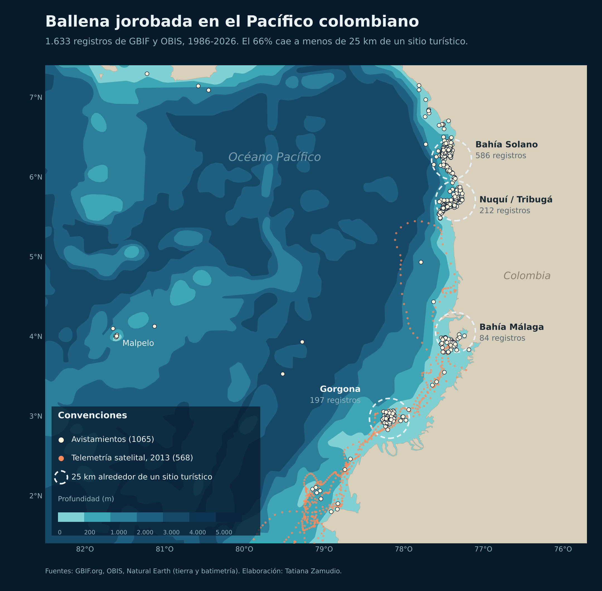

# humpback-habitat-colombia

Modelo abierto y reproducible del hábitat estacional de la ballena jorobada (*Megaptera novaeangliae*) en el Pacífico colombiano, construido con avistamientos de GBIF y OBIS y variables oceánicas de Earth Engine, con corrección del sesgo de muestreo turístico.

## Contexto

La población del Hemisferio Sur (stock G de la IWC) llega al Pacífico colombiano entre mayo y diciembre para reproducirse y criar. El área Gorgona-Tribugá-Malpelo está reconocida como Área Importante para Mamíferos Marinos (IMMA).

Casi todos los registros públicos vienen de zonas de avistamiento turístico (Bahía Solano, Nuquí, Bahía Málaga, Gorgona). Un modelo que no corrija ese sesgo termina mostrando dónde hay lanchas, no dónde hay ballenas. Este repositorio busca resolver eso con código abierto y que se actualice cada temporada.

## Fase 0: qué datos hay

El primer paso fue responder una pregunta simple: ¿hay suficientes registros públicos de ballena jorobada en el Pacífico colombiano para construir un modelo? El notebook `notebooks/01_fase0_datos.ipynb` descarga todos los registros de GBIF y OBIS dentro de la zona de estudio (82,5° O a 77° O, 1,4° N a 7,4° N), quita los que no tienen fecha, los duplicados entre las dos fuentes y los que caen en tierra.

Resultado: **1.633 registros útiles** (1.631 de GBIF y 2 de OBIS), cinco veces el mínimo de 300 que se fijó para seguir. Pero los datos no son homogéneos, y las dos figuras siguientes muestran por qué.

### Dónde están los registros



**Qué muestra.** Cada punto blanco es un avistamiento y cada punto coral es una posición de telemetría satelital. Los círculos punteados marcan 25 km alrededor de los cuatro sitios de avistamiento turístico (Bahía Solano, Nuquí y Tribugá, Bahía Málaga y Gorgona), con el número de registros que cae dentro de cada uno. El fondo es la profundidad del mar: turquesa en la plataforma continental (menos de 200 m) y azul noche en las cuencas de hasta 5.000 m.

**Cómo leerlo.**
- **Sesgo turístico.** El 66 % de los registros cae dentro de los círculos; solo Bahía Solano reúne 586. Esto refleja dónde salen las lanchas, no solo dónde están las ballenas.
- **La plataforma importa.** El 92 % de los avistamientos y el 56 % de la telemetría están sobre fondos de menos de 200 m. La telemetría no depende de las lanchas, así que esa preferencia por aguas someras parece real.
- **La telemetría dibuja rutas.** Las ballenas marcadas en 2013 bajan pegadas a la costa hacia Ecuador. Son los registros más valiosos para corregir el sesgo.
- Mar adentro hay muy pocos registros, casi todos alrededor de la isla de Malpelo.

**Fuentes.** Registros: [GBIF.org](https://www.gbif.org) y [OBIS](https://obis.org), descargados con sus API públicas. Línea de costa y batimetría: [Natural Earth](https://www.naturalearthdata.com), escala 1:10 millones. Figura generada con `scripts/mapa_avistamientos.py`.

### Cuándo se tomaron


**Qué muestra.** A la izquierda, los registros por año; a la derecha, por mes. En las dos, el turquesa son avistamientos y el coral es telemetría satelital, apilados. La franja más clara en la gráfica mensual marca la temporada de cría, de mayo a diciembre.

**Cómo leerlo.**
- **El pico de 2013 no es un año con más ballenas.** Son 568 posiciones de telemetría de pocos animales marcados, registrados muchas veces. Para el modelo se tratan aparte.
- **Los avistamientos despegan desde 2016**, cuando plataformas de ciencia ciudadana como Happywhale e iNaturalist empiezan a recibir fotos de turistas y operadores. En 2020 casi no hay registros.
- **La curva mensual sigue la temporada turística.** La mitad de los registros cae en julio, sobre todo por la telemetría; los avistamientos se reparten de julio a octubre. Mayo casi no tiene registros, aunque las ballenas llegan hacia finales de mayo (Avila et al., 2020).

**Fuentes.** Registros: [GBIF.org](https://www.gbif.org) y [OBIS](https://obis.org). Los conjuntos de datos con más registros son Happywhale (932), una campaña de telemetría satelital de 2013 (567), iNaturalist (92) y los cruceros de mamíferos marinos de la NOAA (SWFSC, 1987-2000). Figura generada con `scripts/tiempo_avistamientos.py`.

## Fases

| Fase | Qué hace | Estado |
|---|---|---|
| 0 | Descarga y conteo de avistamientos (GBIF, OBIS): mapa, año, mes, sesgo | Hecha |
| 1 | Variables oceánicas en Earth Engine (temperatura, clorofila, batimetría) y puntos de fondo corregidos por esfuerzo | En curso |
| 2 | Modelo de hábitat con fondo de muestreo ponderado por esfuerzo | Pendiente |
| 3 | Mapa estacional automatizado con GitHub Actions | Pendiente |

Criterio de la fase 0: con 300 registros útiles o más (fecha, coordenadas, en el mar y sin duplicados) se sigue con el modelo en el Pacífico colombiano. Con menos, la zona se amplía al rango de la población G (Panamá, Costa Rica, Ecuador).

## Estructura

```
notebooks/
  01_fase0_datos.ipynb       descarga, limpieza, mapa y gráficas
  02_fase1_variables.ipynb   variables del mar en Earth Engine y puntos de fondo
scripts/
  mapa_avistamientos.py      mapa del README: avistamientos sobre la batimetría
  tiempo_avistamientos.py    gráficas de registros por año y por mes
data/                        datos descargados (no se versionan)
docs/img/                figuras para este README
```

## Cómo correrlo

1. `notebooks/01_fase0_datos.ipynb` en Google Colab: descarga los avistamientos. No necesita GPU.
2. `notebooks/02_fase1_variables.ipynb`: requiere una cuenta de Earth Engine con un proyecto de Google Cloud.

## Fuentes de datos

- GBIF, Global Biodiversity Information Facility: https://www.gbif.org
- OBIS, Ocean Biodiversity Information System: https://obis.org
- Natural Earth (línea de costa y batimetría): https://www.naturalearthdata.com

Cada registro conserva el conjunto de datos de origen; al publicar resultados se citan los conjuntos usados según la licencia de cada uno.

## Referencias

- Avila, I. C., Dormann, C. F., García, C., Payán, L. F. y Zorrilla, M. X. (2020). Humpback whales extend their stay in a breeding ground in the Tropical Eastern Pacific. *ICES Journal of Marine Science*, 77(1), 109-118.
- IUCN MMPATF. Gorgona-Tribugá-Malpelo IMMA, factsheet.
- Palacios, D. M. et al. (2012). Cetacean distribution and relative abundance in Colombia's Pacific EEZ. *Journal of Cetacean Research and Management*.

## Autora

Tatiana Zamudio, ingeniera topográfica, magíster en Inteligencia Artificial.
